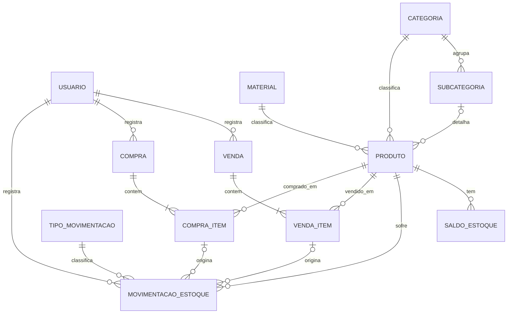

# Aplicação web Nobreza Jóias — 01. Planejamento técnico e funcional

**Status:** versão 0.2, **aprovada pelo usuário em 2026-11-10**, com as decisões da seção "Decisões de 2026-11-10" e da seção G.2. As perguntas ao parceiro (G.1) e as decisões da trilha do cliente continuam em aberto. Nenhum código, migration ou banco foi criado até esta data.

**Escopo:** primeira tarefa da fase de aplicação web: estado atual (A), visão do aplicativo (B), MVP (C), arquitetura (D), modelagem inicial (E), roadmap (F) e perguntas (G), com uma recomendação final.

## Como ler este documento

Cada afirmação relevante traz a sua origem:

| Marca | Significado |
|---|---|
| **[O]** | Observado em arquivo do repositório ou das fontes, com referência |
| **[D]** | Declarado pelo usuário ou pelo briefing da fase; não verificado nas fontes |
| **[R]** | Requisito do levantamento com o parceiro de 25/09 (documento acadêmico do Eixo 4, em `docs/referencia/`, não versionado). Também é declaração, não fato observado da operação |
| **[H]** | Hipótese de trabalho, a confirmar |
| **[P]** | Decisão pendente, do usuário ou do parceiro |

Fontes consultadas: `README.md`; `docs/` (arquitetura, decisões D-001 a D-049, inventário das fontes, pendências e dicionário de dados); o PBIP em `powerbi/`; o documento do projeto de DW e o documento do Eixo 4, ambos em `docs/referencia/`; e o briefing da fase de aplicação web. As planilhas reais **não** foram relidas: os números sobre elas vêm de `docs/source_inventory.md` (inspeção de 2026-10-31).

**Nomenclatura:** o projeto já chama o ambiente demonstrativo de "fase 1", e a documentação atual chama de "fase 2" a integração das planilhas reais ao DW. O briefing numera de 1 a 6 as fases internas da aplicação. Para evitar colisão, este documento chama as etapas da aplicação de **A0 a A9** (seção F). Renumerar as fases do projeto é a decisão U2 (seção G.2).

## Resumo

- O projeto tem hoje um DW demonstrativo completo e testado, com dados 100% sintéticos, mas nada que funcione como sistema operacional. Da fase 1 se reaproveitam o conhecimento de domínio, os padrões técnicos e a camada analítica, não o banco.
- A operação é pequena: cerca de 200 peças vendidas por ano [D] e poucos usuários [D]. O maior risco não é o desempenho. É o sistema não refletir como a joalheria trabalha: identificação das peças, maletas, saídas não comerciais e preço por índice.
- As fontes divergem sobre materiais, categorias e identificação das peças (seção A.5). A planilha observada sugere **um código por peça física também em folheados e prata**, o contrário da hipótese registrada no briefing. Isso precisa ser confirmado com o parceiro antes de modelar.
- MVP recomendado: login com dois perfis; catálogo e estoque com implantação de saldo inicial; vendas com baixa automática e cancelamento com estorno; compras por lote; saídas não comerciais com motivo; consultas operacionais simples. Clientes, fornecedores, financeiro, fotos e comprovantes ficam para depois.
- Arquitetura adotada: **Next.js full-stack** + PostgreSQL, num único projeto, com um **banco operacional separado** do `dw_joalheria`. Demonstração executada localmente; hospedagem de produção a decidir na trilha do cliente.
- Entrega em duas trilhas: uma **demonstração funcional com dados fictícios** em duas semanas, e a implantação no cliente depois. A entrevista com o parceiro deixa de bloquear o código da demonstração e passa a bloquear só a implantação.
- Próximo passo: aprovar esta versão e, em seguida, a especificação da demonstração (modelo lógico e telas), que antecede a primeira tarefa de código.

## Decisões de 2026-11-10

Contexto dado pelo usuário: o projeto nasceu de um documento acadêmico que propõe o sistema a um cliente real. O escopo estava restrito ao banco, ao estoque e ao Power BI para acompanhar as entregas; a parte web é a entrega que falta, e as restrições de escopo foram retiradas.

| Tema | Decisão | Efeito neste documento |
|---|---|---|
| Natureza da entrega | Demonstração funcional agora; implantação no cliente depois | Duas trilhas (F.1). Dados fictícios e marcados, nunca copiados das planilhas (D.10) |
| Stack | Next.js full-stack + PostgreSQL | D.1 a D.4 reescritas; o backend existe, mas não como serviço separado |
| Escopo da primeira versão | Núcleo operacional | C.2 mantida; C.3 continua como lista de evoluções |
| Prazo | Até duas semanas | Calendário e linha de corte (F.1) |
| Relatórios do Power BI | Requisito vital: o cliente acessa os relatórios do Power BI pela aplicação web | Seção D.11 nova. Na demonstração: "Publicar na Web" sobre o DW sintético atual (U12 e U13); para o cliente, decisão na trilha do cliente |

Como a demonstração convive com o que o parceiro ainda não respondeu (Q1 a Q7):

- materiais, categorias e tipos de saída são cadastros configuráveis, não listas fixas no código;
- o modo de controle por produto (E.4) atende tanto a peça única quanto o item em quantidade;
- as entidades condicionais da E.2 (locais, parâmetro de preço, modelo) ficam fora da demonstração e entram, se confirmadas, na revisão do modelo da trilha do cliente.

---

## A. Estado atual

### A.1 O que já foi desenvolvido

| Componente | Situação | Origem |
|---|---|---|
| Banco `dw_joalheria` (PostgreSQL 18.6 local) | 5 esquemas `*_demo` e 21 migrations; os esquemas reais (`staging`, `dw`, `bi`, `audit`) não existem | [O] `README.md`, `docs/architecture.md` |
| Dados | 100% sintéticos (`SINTETICO_DEMO`): 150 produtos, 2024–2025, 6.370 itens vendidos, 1.789 comprados e 8.377 movimentações | [O] `README.md` |
| ETL | Gerador determinístico, validação, cargas e 24 verificações em PL/pgSQL, orquestrados por PowerShell + `psql`; idempotência testada | [O] `etl/sql/demo/`, `docs/etl_runbook.md` |
| Modelo dimensional | `dim_produto`, `dim_data` e `dim_tipo_movimentacao`; fatos de venda, compra, movimentação e snapshot; preço do ouro versionado | [O] `docs/data_dictionary.md` |
| Consumo | 12 views em `bi_demo`; perfil `bi_leitura` somente leitura | [O] `db/views/`, `db/seguranca/` |
| Power BI | PBIP em modo Import, com 8 páginas (7 funcionais e 1 auxiliar vazia) e 61 medidas | [O] `pages.json`, `Medidas.tmdl` |
| Conferência | Scripts de reconciliação PostgreSQL × relatório | [O] `tests/reconciliacao/` |
| Fontes reais | Inventariadas em modo somente leitura; **não** carregadas | [O] `docs/source_inventory.md` |
| Entrega acadêmica | Pacote ZIP REV3, fora do repositório | [D] |
| Aplicação web | Nada implementado. Existem os requisitos acadêmicos (RF001–RF027, RNF001–RNF005) e a arquitetura proposta (React/Next.js, Node.js/NestJS e PostgreSQL) | [R] |

### A.2 Tecnologias em uso

| Tecnologia | Uso atual | Relevância para a aplicação |
|---|---|---|
| PostgreSQL 18.6 (serviço local `postgresql-x64-18`) | DW demonstrativo | Banco operacional de desenvolvimento, em outro banco |
| SQL e PL/pgSQL | Gerador, validação, cargas e funções | Restrições, gatilhos e funções transacionais do banco operacional; ETL para o DW |
| PowerShell 5.1 + `psql` (`PG_BIN`) | Orquestração e testes | Scripts de operação local (backup, ETL) |
| Python 3.14 | Verificador estático de SQL; reservado para ler XLSX | Eventual importação assistida das planilhas |
| Node.js 22.15 e npm 10.9 ([O], conferidos em 2026-11-05) | Geradores de páginas PBIR (`tools/powerbi/`) | Já disponíveis para uma stack JavaScript/TypeScript |
| Power BI Desktop (PBIP, TMDL, DAX) | Relatório demonstrativo | Camada analítica a reaproveitar |
| Git e GitHub | Versionamento | Mesmo fluxo |

### A.3 O que pode ser reaproveitado

| Item | Como reaproveitar |
|---|---|
| Tipos de movimentação com sinal (D-013, `dim_tipo_movimentacao`) | Base do domínio de movimentações da aplicação, com os mesmos códigos sempre que possível, para o ETL mapear 1:1 |
| Separação entre venda e movimentação com evento de origem comum (D-015) | No banco operacional, a origem passa a ser uma FK real (item de venda ou de compra), não um ID sintético |
| Preço versionado sem UPDATE/DELETE (D-017) e função única de preço sugerido (D-033) | Padrão para o valor do índice ou preço do ouro, se o parceiro confirmar a regra (D-016) e a unidade de referência |
| Regras de qualidade: rejeição sempre registrada e auditoria por execução | ETL do banco operacional para o DW |
| Registro de migrations com SHA-256 (D-038) | Ideia reaproveitável; a ferramenta de migrations da aplicação é escolhida na fundação (A5) |
| Contrato de colunas das views `bi_demo` | As views reais mantêm os mesmos nomes (já decidido em `docs/architecture.md`), e o relatório funciona com poucas mudanças |
| Relatório (7 páginas, 61 medidas) e scripts de reconciliação | Camada analítica sobre os dados reais, na etapa A8 |
| Inventário das fontes e perguntas da antiga "fase 2" | Entram no roteiro de perguntas ao parceiro (G.1) |
| Requisitos RF/RNF do Eixo 4 | Backlog de partida, classificado na seção C.4 |

### A.4 O que não deve ser reaproveitado diretamente

| Item | Motivo |
|---|---|
| Banco `dw_joalheria` e esquemas `*_demo` como banco operacional | São um modelo analítico (desnormalizado, carga em lote), com dados sintéticos e marcação `SINTETICO_DEMO` imposta por CHECK. Proibido pelo briefing [D] |
| Dados e geradores sintéticos | Não podem entrar em tabelas de produção. Os dados de teste da aplicação serão fixtures próprias, em banco de teste |
| `dim_produto` como cadastro | É uma dimensão SCD 1 com os domínios fixos da demo (`Ouro`, `Prata`, `Folheado`); a taxonomia real não foi confirmada |
| Listas de domínio da demo (materiais, tipos de peça, tamanho só em anel para ouro) | Foram decididas para dados sintéticos; na aplicação viram hipóteses a confirmar. D-034 veio do usuário e deve ser revalidada com o parceiro |
| Usuário `postgres` no `.env` | Aceitável apenas na demo local; a aplicação usa papéis com privilégio mínimo |
| Conexão fixa do Power BI em `bi_demo` (D-043) | Dados reais exigem parametrização ou relatório separado; demo e dados reais nunca se misturam |
| Estrutura das planilhas como modelo do sistema | As planilhas são o problema a resolver (sem quantidade, sem ID de venda, local em texto livre, colunas deslocadas). Servem de evidência, não de especificação |
| `tools/powerbi/` | Específico da geração de páginas PBIR |

### A.5 Divergências entre as fontes

| Tema | Briefing [D] | Requisitos de 25/09 [R] | Fontes observadas [O] | Consequência |
|---|---|---|---|---|
| Materiais | Ouro, Prata, Semijoias, Folheados e Relógios | RF004: Ouro, Prata, Platina, Folheados dourados, escuros e prateados, Rodinados. O resumo do mesmo documento cita semijoias e relógios | FOLHEADOS (folheados e prata `R07…`); CLS (ouro, com categoria "relógio"); nenhuma fonte de relógios ou platina | Material é domínio configurável; a lista inicial vem do parceiro (Q2) |
| Categorias | Anéis, alianças, brincos, colares, correntes, pingentes, solitários, pulseiras e outros | RF004: 13 categorias, incluindo bracelete, cordões, piercing, escapulários, tornozeleiras e "outros" | O prefixo numérico do código sugere o tipo de peça (1 = anel, 4 = brinco…); CLS com 18 grafias; aba CATEGORIAS com uma única célula | Nenhuma fonte define o que é "subcategoria" |
| Identificação | Código por unidade no ouro; várias unidades do mesmo modelo nos folheados (crença do proprietário) | RF004: "código único" | FOLHEADOS: 1.541 linhas, sem coluna de quantidade, apenas 6 códigos repetidos e 948 descrições distintas | A planilha sugere **um código por peça** também em folheados e prata. Ver E.4 |
| Volume | Cerca de 200 peças vendidas por ano | — | FOLHEADOS: 118 linhas com data de venda entre 2024-10 e 2026-10, sem o ouro, que não tem fonte de vendas | Ordem de grandeza compatível com uma operação de baixíssimo volume |
| Compras | — | RF018: registro de compras | FOLHEADOS: 693 peças com data de compra, em 11 datas (média de ~63 peças por data) | A entrada é por **lote grande**: o fluxo de compra precisa de cadastro rápido em série |
| Locais | — | — | LOCAL DO ESTOQUE: ESTOQUE, MALETA 1, 2 MALETA, ARMARIO, VENDIDO, "novo", "sumiu" e nomes de pessoas (128 linhas) | Possível consignação ou venda por maleta; afeta o modelo de saldo (Q3) |
| Desempenho e disponibilidade | Poucos usuários | RNF002: até 50 usuários simultâneos; RNF003: 99,5% de disponibilidade | — | Metas desproporcionais ao porte; rever com o parceiro |
| Stack | React/Next.js, Node.js/NestJS e PostgreSQL como proposta, não como decisão | O mesmo conjunto, declarado no documento acadêmico | — | Decidido em 2026-11-10: Next.js full-stack, sem NestJS (D.2) |
| Documentação interna | — | — | `README.md` e `docs/architecture.md` ainda descrevem 6 páginas e 50 medidas; o PBIP tem 7 páginas funcionais e 61 medidas | Sincronizar na etapa A0 |

---

## B. Visão do aplicativo futuro

### B.1 Objetivo

A aplicação deve ser a fonte oficial dos dados operacionais da Nobreza Jóias: cadastro de produtos, saldo de estoque, compras, vendas e demais movimentações, com histórico auditável. O DW e o Power BI passam a consumir esses dados por ETL e não servem para cadastrar nem movimentar [D].

O problema central relatado é decidir as compras sem saber o que foi vendido, de qual subcategoria e em que época [R]. Por isso, o valor do MVP está em **registrar cada venda e cada saída de forma confiável desde o primeiro dia**, mais do que em telas analíticas.

### B.2 Usuários

| Perfil | Quem | Situação |
|---|---|---|
| Administrador | Proprietário | [D] |
| Vendedor | Funcionários autorizados | [D]; quantidade, funções e acesso a custos desconhecidos |
| Gerente | — | Previsto em RF002 [R], sem função distinta conhecida. Só criar se o parceiro descrever permissões diferentes |

Hipóteses de uso [H]: de 1 a 3 usuários, e vendas também fora de um ponto fixo. Os clientes vêm do círculo pessoal, do clube e do trabalho do proprietário (cerca de 40 clientes recorrentes [R]), e a planilha registra peças em maletas [O]. Se isso se confirmar, o celular é o dispositivo principal da venda e o sistema precisa estar acessível pela internet.

### B.3 Módulos

| Módulo | Conteúdo | Requisitos de origem |
|---|---|---|
| Acesso | Login, sessão, troca de senha, perfis e permissões | RF001–RF003, RNF001 |
| Cadastros de domínio | Materiais, categorias e subcategorias (e locais, se aprovados) | RF004 |
| Produtos | Cadastro, edição, consulta e desativação | RF004 |
| Estoque | Saldo, implantação, entradas e saídas avulsas, ajustes e histórico | RF005–RF007 |
| Vendas | Registro com vários itens, preço praticado, desconto e cancelamento com estorno | RF012, RF013, RF016 |
| Compras | Registro por lote, custo e entrada automática | RF018 |
| Consultas | Estoque atual, sem estoque, parados, mais vendidos, recentes, totais do dia e do mês | RF007, RF024, RF025 |
| Auditoria | Quem fez o quê e quando; antes e depois das alterações cadastrais | RF006, RNF001 |
| Integração | Extração para o DW | Objetivo geral do Eixo 4 |

### B.4 Fluxos de uso principais

1. **Venda (diária):** buscar a peça por código ou descrição, adicioná-la à venda, conferir ou alterar o preço praticado e confirmar. O sistema baixa o estoque e numera a venda na mesma transação.
2. **Cancelamento de venda:** localizar a venda, informar o motivo e confirmar. A venda fica CANCELADA e o estoque volta por estorno; nada é apagado.
3. **Recebimento de lote (compra):** abrir uma compra em rascunho, incluir os itens (produto existente ou cadastro rápido de peça nova, com custo) e confirmar. O sistema gera as entradas.
4. **Saída não comercial:** escolher o produto, o tipo (presente, perda, roubo…) e o motivo, e confirmar. O estoque diminui sem gerar faturamento.
5. **Ajuste de inventário:** quando a contagem diverge do sistema, registrar um ajuste positivo ou negativo, com motivo e responsável.
6. **Implantação (uma vez, no início):** cadastrar os produtos em estoque e o saldo inicial a partir de uma contagem física.
7. **Consultas:** saldo atual, histórico de um produto, produtos sem estoque, parados há N dias e mais vendidos no período.
8. **Gestão de usuários (administrador):** criar, desativar e redefinir senha.

### B.5 Funcionalidades prioritárias

Em ordem: (1) venda com baixa automática; (2) catálogo com saldo confiável e implantação; (3) saídas não comerciais e ajustes com motivo; (4) compras por lote; (5) consultas de parados e mais vendidos. A justificativa está na seção C.5.

---

## C. Proposta de MVP

### C.1 Princípios

- Cada incremento termina utilizável e testado.
- O MVP registra os fatos operacionais (o que entrou ou saiu, por quê, quando, por quem e por quanto). Não calcula margem, CMV nem giro enquanto não houver política de valorização.
- Nenhum dado pessoal de cliente no MVP.
- Domínios (materiais, categorias, tipos de saída) são configuráveis, não fixados no código.

### C.2 Entregas

| Incremento | Conteúdo | Pronto quando |
|---|---|---|
| **MVP-0 Fundação** | Estrutura do projeto, banco operacional separado, migrations, login e logout, troca de senha, redefinição pelo administrador, perfis Administrador e Vendedor, auditoria, cadastros de domínio, layout responsivo | O usuário entra pelo celular e pelo desktop; as permissões são verificadas no backend; os testes passam |
| **MVP-1 Catálogo e estoque** | Produtos (incluir, editar, consultar, desativar), modo de controle (E.4), implantação de saldo inicial, saídas não comerciais e ajustes com motivo, saldo atual, histórico por produto e lista de produtos sem estoque | O saldo de cada produto é igual à soma das suas movimentações (invariante I2) |
| **MVP-2 Vendas** | Venda com vários itens, preço praticado e desconto por item, número sequencial, baixa automática, cancelamento com estorno e motivo, consulta de vendas | Invariantes I1, I4 e I5 cobertos por testes de integração no PostgreSQL |
| **MVP-3 Compras** | Compra em rascunho, cadastro rápido de peça nova dentro da compra, custo unitário, confirmação com entrada automática, cancelamento quando o saldo permitir, consulta | Um lote de ~60 peças novas pode ser registrado com rascunho salvo e retomado depois |
| **MVP-4 Consultas** | Tela inicial com vendas do dia e do mês, mais vendidos, parados há N dias (configurável), sem movimentação, compras e vendas recentes; baixo estoque só para produtos com mínimo informado | Resultados conferidos por consultas SQL independentes |

A implantação em produção (A7) exige do MVP-0 ao MVP-3. O MVP-4 pode entrar logo depois. Para a demonstração, a ordem de entrega e a linha de corte estão na seção F.1.

### C.3 Fora do MVP

| Item | Motivo | Quando reavaliar |
|---|---|---|
| Clientes (RF008–RF011) | LGPD e necessidade não demonstrada; o Power BI não depende deles | Depois da resposta a Q9 |
| Fornecedores (RF017, RF019) | Fora do escopo do projeto acadêmico. A aba RAMON sugere um fornecedor com pagamentos parciais, o que é assunto financeiro | Se o parceiro precisar consultar compras por fornecedor |
| Financeiro (RF020–RF023), comissões (RF015) e fidelidade (RF010) | Fora do escopo; faturamento e ticket médio ficam no Power BI | Etapa futura, com aprovação |
| Venda online, catálogo público, e-commerce e gateway (RF012 parcial, RF027) | Fora do escopo | — |
| Fotos | Exigem armazenamento de arquivos e aumentam o custo de hospedagem | Versão 1.1, se o parceiro precisar delas para identificar peças |
| Recuperação de senha por e-mail (RF001 parcial) | Exige serviço de e-mail; com poucos usuários, o administrador redefine a senha | Versão 1.1 |
| Comprovantes em PDF ou por e-mail (RF014) | Não são essenciais ao controle de estoque | Versão 1.1 |
| Exportação para Excel ou PDF (RF026) | O Power BI já cobre a exportação analítica | Versão 1.1 |
| Inventário físico periódico com contagem guiada (RF005 parcial) | No MVP, a implantação e os ajustes cobrem a necessidade | Versão 1.1 |
| Previsão de demanda | O objetivo do Eixo 4 cita "estimativas de demanda", mas não há requisito confirmado; a prioridade é a análise descritiva | Só com histórico real suficiente e aprovação |
| Modo offline | Complica a consistência do estoque | Só se o parceiro vender sem internet |
| Emissão fiscal (NF-e) | Fora do escopo; o sistema não é fiscal | — |

### C.4 Requisitos originais × MVP

| Requisito [R] | No MVP | Observação |
|---|---|---|
| RF001 Autenticação | Parcial | Login sim; recuperação feita pelo administrador |
| RF002 Perfis | Parcial | Administrador e Vendedor; Gerente só se houver diferença real |
| RF003 Permissões | Sim | Matriz fixa por perfil, aplicada no backend |
| RF004 Cadastro de joias | Parcial | Sem fotos; "pedras preciosas" como texto; campos de índice conforme Q6 |
| RF005 Controle de inventário | Parcial | Entradas, saídas e ajustes sim; inventário guiado depois |
| RF006 Rastreabilidade | Sim | Histórico de movimentações e auditoria |
| RF007 Alertas de estoque | Parcial | Sem estoque e parados, sim. Baixo estoque só com mínimo por produto: o projeto de DW registra que não há requisito confirmado de estoque mínimo |
| RF008–RF011 Clientes, fidelidade e datas comemorativas | Não | C.3 |
| RF012 Registro de vendas | Parcial | Venda presencial; forma de pagamento só como informação, se Q5 confirmar |
| RF013 Carrinho | Sim | Itens, quantidades e desconto |
| RF014 Comprovantes | Não | C.3 |
| RF015 Comissões | Não | C.3 |
| RF016 Cancelamento | Sim | Estorno do estoque, sem apagar histórico |
| RF017 e RF019 Fornecedores | Não | C.3 |
| RF018 Registro de compras | Sim | MVP-3 |
| RF020–RF023 Financeiro | Não | C.3 |
| RF024 Dashboard | Parcial | Sem "clientes ativos" e sem indicadores financeiros |
| RF025 Relatórios | Parcial | Vendas por período, estoque e parados; por vendedor se houver mais de um |
| RF026 Exportação | Não | C.3 |
| RF027 Catálogo online | Não | C.3 |
| RNF001 Segurança | Sim | D.8 |
| RNF002 Desempenho | Rever | Páginas em menos de 3 s, sim. 50 usuários simultâneos é desproporcional; proposta: 5 |
| RNF003 Disponibilidade de 99,5% | Rever | Depende da hospedagem (D.7) |
| RNF004 Backup | Sim | Diário, com teste de restauração |
| RNF005 Responsividade | Sim | Celular e desktop |

### C.5 Justificativa das prioridades

- A venda é o evento mais frequente e é o que falta para responder à pergunta do proprietário. Cada dia sem registro estruturado é histórico perdido, porque o histórico real só começa na primeira coleta.
- Vendas vêm antes de compras: depois da implantação, as vendas começam no primeiro dia, enquanto os lotes chegam com semanas de intervalo (11 datas em 18 meses [O]).
- As saídas não comerciais entram cedo porque, sem elas, perdas e presentes acabam registrados como venda ou como ajuste genérico.
- As consultas ficam por último porque dependem de dados acumulados e porque o Power BI já cobre a análise.

---

## D. Arquitetura recomendada

### D.1 Visão geral

```
Navegador (celular / desktop)
   │ HTTPS
   ▼
Aplicação Next.js única ── telas React + camada de servidor (regras de negócio)
   │ SQL, com papel de aplicação de privilégio mínimo
   ▼
PostgreSQL — banco operacional, separado do dw_joalheria
   │ leitura por papel de ETL (extração incremental)
   ▼
dw_joalheria — esquemas reais staging/dw/bi/audit (etapa A8) ──► Power BI
```

### D.2 Avaliação da stack

| Opção | Prós | Contras | Avaliação |
|---|---|---|---|
| A. Next.js full-stack + PostgreSQL | Um único projeto e uma única implantação; mantém React e Next.js do documento acadêmico; TypeScript de ponta a ponta; o backend existe, mas dentro do próprio Next.js | O framework não impõe uma camada de regras de negócio: ela precisa ser separada por convenção (D.4); dispensa o NestJS citado no documento acadêmico | **Adotada** (decisão do usuário, 2026-11-10) |
| B. React (SPA com Vite) + NestJS + PostgreSQL | Camada de regras explícita, com módulos, validação e guardas de permissão | Dois projetos para construir, testar e manter; abandona o Next.js | Recomendação da v0.1, substituída |
| C. Next.js + NestJS (proposta original) | Fiel ao documento acadêmico | Dois servidores Node.js para 1 a 3 usuários: o dobro de configuração, implantação e autenticação entre eles | Não adotada |
| D. Django + PostgreSQL | Autenticação, permissões, painel administrativo e migrations prontos | Foge da stack declarada no trabalho acadêmico | Não adotada |

**O backend é necessário.** O sistema tem login e perfis, é usado por mais de uma pessoa em mais de um aparelho, precisa garantir que venda e baixa de estoque aconteçam juntas e precisa gravar num PostgreSQL que o ETL do DW consiga ler. Nada disso se resolve só no navegador. O que não é necessário é um **serviço** de backend separado.

**Por que a recomendação mudou em relação à v0.1.** A v0.1 preferia a opção B pela camada de regras mais explícita. Com o prazo de duas semanas e a orientação de só ter backend onde for necessário, um único projeto pesa mais do que essa vantagem. O risco da opção A é a regra de negócio se espalhar pelas telas; ele é tratado de duas formas: a camada de domínio isolada (D.4) e os invariantes críticos garantidos pelo próprio PostgreSQL (D.5), que é onde o projeto já tem mais maturidade.

### D.3 Frontend

- Next.js + React + TypeScript. Todas as telas ficam atrás de login; a renderização no servidor é consequência do framework, não um requisito do sistema.
- Prioridade ao celular nas telas de venda e consulta; desktop para cadastros e compras em lote.
- Estilo e componentes: proposta de Tailwind CSS com componentes copiados para o projeto (estilo shadcn/ui), pelos critérios de formulários, tabelas com filtro, responsividade e acessibilidade. A confirmação fica na especificação da tarefa de fundação. Nenhuma outra dependência sem justificativa.
- Sem modo offline.

### D.4 Backend (dentro do Next.js)

- Sem serviço separado e sem API REST pública na demonstração: as telas chamam funções de servidor do próprio Next.js. Um endpoint HTTP só é criado quando houver um consumidor externo; o DW lê o banco, não uma API.
- **Camada de domínio isolada** numa pasta própria de código de servidor: uma função por operação de negócio (confirmar venda, cancelar venda, confirmar compra, registrar saída, ajustar), sem dependência de React. As telas e as funções de servidor apenas chamam essa camada, e é nela que a permissão do perfil é verificada.
- Cada operação de negócio é uma única transação no banco.
- Regras de negócio no servidor **e** invariantes críticos no banco (D.5). A interface apenas esconde o que o perfil não pode usar.
- Confirmação de venda e de compra com chave de idempotência gerada pelo cliente e restrição de unicidade no banco (I9).
- Acesso a dados: migrations em SQL versionadas e consultas com um construtor de SQL tipado (proposta: Kysely). Motivo: o modelo depende de CHECK, gatilhos, bloqueio de linha e privilégios, que os ORMs tratam mal, e o projeto já trabalha em SQL.
- Testes: unitários para as regras; **de integração contra o PostgreSQL 18 local**, em banco descartável próprio (o projeto não usa Docker), para todos os invariantes de estoque; ponta a ponta só para o fluxo de venda, se o prazo permitir.
- Localização proposta: pasta `web/` na raiz do repositório, com as migrations da aplicação dentro dela. `db/migrations/` continua exclusiva do DW.

### D.5 Banco operacional

- **Banco separado** (nome a definir, por exemplo `nobreza_app`), e não um esquema dentro de `dw_joalheria`, porque ciclo de vida, backup, permissões e hospedagem são diferentes. Em desenvolvimento, fica no mesmo PostgreSQL 18 local.
- Papéis: dono das migrations; papel da aplicação, só com DML e sem UPDATE/DELETE nas tabelas imutáveis; papel de leitura para o ETL. A aplicação nunca usa o `postgres`.
- Tipos: `timestamptz` (fuso America/Sao_Paulo na apresentação); valores em `numeric(14,2)`; quantidades inteiras, em peças; peso em gramas, nunca somado a quantidades.
- Invariantes garantidos também pelo banco: saldo não negativo por CHECK; códigos únicos; movimentações imutáveis; coerência entre o tipo de movimentação e a sua origem.
- Compatibilidade: evitar recursos exclusivos do PostgreSQL 18 (por exemplo, colunas geradas VIRTUAL, ver D-032) enquanto a versão da hospedagem não for conhecida.
- Backup diário, com retenção definida e restauração testada antes da implantação (RNF004).

### D.6 Autenticação e autorização

- Sessão no servidor, com cookie `HttpOnly`, `Secure` e `SameSite`; sessão revogável e com expiração por inatividade; proteção contra CSRF nas requisições que alteram dados.
- Senhas com Argon2id (ou bcrypt com custo adequado) e limite de tentativas de login.
- O primeiro administrador é criado por comando de linha, com a senha informada na hora, nunca em código ou seed versionado.
- Recuperação de senha no MVP: o administrador redefine e o usuário troca a senha no primeiro acesso.
- Matriz de permissões por perfil, verificada no backend. Proposta inicial [H]: o Vendedor consulta produtos e saldos e registra vendas; o Administrador faz o resto (usuários, ajustes, cancelamentos, compras, custos). Se o vendedor pode ver custos é a pergunta Q8.

### D.7 Hospedagem

| Alternativa | Custo | Disponibilidade | Segurança | Manutenção | Acesso fora da loja |
|---|---|---|---|---|---|
| 1. Notebook do parceiro, só na rede local | Sem mensalidade | Depende do notebook ligado; sem redundância | Dados em casa; risco físico (furto, falha de disco) | Atualizações, backup e energia por conta do parceiro | Não |
| 2. Notebook + túnel (por exemplo, Cloudflare Tunnel ou Tailscale) | Baixo ou nenhum | Igual à anterior | HTTPS pelo túnel, mas expõe uma máquina de uso pessoal | Igual à anterior, mais o túnel | Sim |
| 3. Servidor virtual (VPS) com Node.js e PostgreSQL | Mensalidade baixa (cotar) | Boa | Depende de configurar firewall, TLS e atualizações | Alta: alguém precisa administrar o servidor | Sim |
| 4. Plataforma gerenciada (PaaS) para a aplicação + PostgreSQL gerenciado | Mensalidade baixa a moderada (cotar; planos gratuitos costumam ter hibernação, expiração ou limites de backup) | Boa | TLS e atualizações pela plataforma; backups do provedor | Baixa | Sim |

Recomendação preliminar: desenvolvimento e demonstração acadêmica locais; **produção na alternativa 4**, porque ninguém no projeto tem o papel de administrador de servidor e o provável uso pelo celular fora da loja exige acesso pela internet. Um notebook como servidor de produção não é recomendado: não foi feito para ficar sempre ligado, é alvo de furto e concentra todos os dados num único disco. A alternativa 2 serve para um piloto sem custo, se o parceiro preferir. **[P]** Decidir depois das respostas a Q8 e Q15 (onde a venda acontece e qual o orçamento).

### D.8 Segurança e privacidade

- HTTPS obrigatório (HSTS), cookies seguros e CORS fechado (mesma origem).
- Validação no backend e restrições no banco; consultas sempre parametrizadas.
- Segredos só em variáveis de ambiente ou no cofre do provedor; `.env.example` sem valores reais.
- Auditoria de login, gestão de usuários, ajustes, cancelamentos e alterações de preço ou custo.
- Logs sem dados pessoais e sem segredos.
- Dependências atualizadas e verificadas quanto a vulnerabilidades.
- LGPD: no MVP, os únicos dados pessoais são os dos usuários (nome e login). Clientes, só com finalidade definida, base legal e campos mínimos (C.3).
- Referência de verificação: OWASP Top 10.

### D.9 Integração futura com o ETL e o Power BI (etapa A8)

- O banco operacional é a fonte oficial. O DW real usa os esquemas `staging`, `dw`, `bi` e `audit`, criados somente na A8.
- O desenho operacional já facilita a extração: IDs crescentes e tabelas imutáveis permitem carga incremental sem duplicidade; os cadastros têm `atualizado_em`; os cancelamentos ficam registrados como eventos.
- Mapeamento previsto:

| Operacional | DW | Observação |
|---|---|---|
| `venda` + `venda_item` | `fato_venda_item` | `id_venda` passa a ser um identificador comercial real; ticket médio e associação valem **a partir da implantação** |
| `compra_item` | `fato_compra_item` | O custo unitário é definido pelo próprio sistema |
| `movimentacao_estoque` | `fato_movimentacao_estoque` | Mesmos códigos de tipo; a dimensão real recebe os tipos novos (E.6) |
| Saldo diário calculado a partir das movimentações | `fato_snapshot_estoque` | Somente a partir da data de implantação |
| `produto` e domínios | `dim_produto` | Decidir SCD 1 ou 2 para mudanças de categoria (pendência do projeto de DW) |

- Transporte: se a produção estiver na nuvem e o DW for local, extração agendada, por papel somente leitura, para o staging local. O mecanismo é escolhido na A8.
- Power BI: reaproveitar as 7 páginas com views reais de mesmas colunas, parametrizando a conexão (melhoria registrada em D-043) ou mantendo um relatório separado. Demo e dados reais nunca se misturam.
- Margem, CMV, estoque valorizado e giro por custo continuam bloqueados até existir uma política de valorização. O sistema guarda o custo de cada entrada para que essa política possa ser aplicada depois.
- **[P] U6:** histórico das planilhas. Recomendação: o banco operacional começa na implantação; as vendas antigas da planilha, sem ID de venda, entram no DW como fonte histórica separada e marcada, nunca como vendas da aplicação.

### D.10 Ambientes e dados de teste

| Ambiente | Banco | Dados |
|---|---|---|
| Desenvolvimento | PostgreSQL local, banco próprio | Fixtures fictícias e marcadas, só para desenvolvimento |
| Teste automatizado | Banco descartável, recriado pelos testes | Fixtures dos testes |
| Demonstração acadêmica | PostgreSQL local, banco próprio | Conjunto fictício e marcado, carregado por comando explícito; nada copiado das planilhas |
| Produção | Hospedagem escolhida | Somente dados reais; nenhum seed fictício |

### D.11 Acesso aos relatórios do Power BI pela aplicação

Requisito [D] de 2026-11-10: é vital que o cliente acesse os relatórios do Power BI por dentro da aplicação web. A aplicação ganha um módulo **Relatórios**, restrito por perfil. Há duas decisões independentes: como o relatório é exibido e quais dados ele mostra.

**Como exibir.** As condições abaixo foram conferidas na documentação da Microsoft (Microsoft Learn) em 2026-11-10. O usuário tem conta educacional no Power BI Service [D].

| Opção | Como funciona | Limitações |
|---|---|---|
| 1. Publicar na web | Link público do Power BI Service exibido num quadro dentro da tela | Qualquer pessoa com o link vê os dados, inclusive o detalhe por trás dos visuais, sem login. Inaceitável para dados reais; aceitável apenas para a demonstração sintética, que já traz o aviso de dados sintéticos. O recurso só aparece se o administrador da organização (aqui, a instituição de ensino) o tiver habilitado. Não aceita layout móvel nem segurança por linha. Quem vê não precisa de conta |
| 2. Incorporação segura | Relatório do Power BI Service num quadro dentro da tela autenticada | Cada pessoa que visualiza precisa de licença Power BI Pro ou Premium por usuário e de uma conta na mesma organização: contas de convidado não são aceitas, então o cliente não pode usar a conta educacional do desenvolvedor. São dois logins, repetidos a cada nova janela do navegador, com pop-ups habilitados; a página precisa estar em HTTPS; a autenticação automática não funciona dentro de aplicativos móveis. A própria Microsoft avisa que a opção deixou de funcionar como antes e recomenda uma solução de incorporação própria |
| 3. Power BI Embedded | O servidor da aplicação obtém um token e exibe o relatório; o cliente não precisa de conta Microsoft | Exige capacidade paga e registro de aplicativo na Microsoft. Custo mensal a cotar, provavelmente desproporcional ao porte |
| 4. Painéis nativos | A aplicação desenha os indicadores principais lendo as mesmas views do DW que o Power BI consome | Não é o Power BI: os visuais são refeitos. Sem licença, sem segundo login e com bom uso no celular. O Power BI continua sendo a ferramenta de análise completa |
| 5. Arquivo para download | A aplicação entrega o PBIX ou um PDF exportado | Estático. O PBIX exige o Power BI Desktop, em Windows |

As opções 1 a 3 exigem o relatório publicado no Power BI Service e uma atualização agendada que alcance o DW. Com o DW num PostgreSQL local, isso requer um gateway de dados, ou o DW hospedado onde o serviço consiga chegar. O gateway em modo pessoal atende modelos em modo Import, mas é um aplicativo interativo: a máquina precisa estar ligada e com a sessão aberta na hora da atualização. Isso pesa na decisão de hospedagem (D.7). Para a demonstração, o gateway é dispensável: os dados importados sobem junto com o relatório publicado e basta republicá-lo depois de uma nova carga.

**Recomendação.**

- Demonstração: opção 1, se a instituição de ensino tiver habilitado "Publicar na Web". O teste é do usuário: no relatório publicado, menu Arquivo → Inserir relatório → Publicar na Web (público). Se o recurso estiver bloqueado, a alternativa é a opção 4 para os indicadores principais, com a opção 5 como complemento.
- Cliente: a opção 1 está descartada para dados reais, e a conta educacional não serve de base, porque é pessoal e ligada à matrícula. A opção 2 exige que o cliente tenha organização própria na Microsoft e licenças pagas, com uma experiência de login frágil. O caminho recomendado é a opção 4 dentro da aplicação, mantendo o Power BI completo para quem tiver licença. A opção 3 só se o orçamento do cliente comportar a capacidade paga.

**Quais dados mostrar.** O relatório atual lê o DW demonstrativo sintético, que não tem relação com os dados lançados na aplicação. Para o relatório refletir o que foi registrado na aplicação é preciso o ETL do banco operacional para o DW, hoje na etapa A8, fora da entrega de duas semanas.

Decisão do usuário (U13): na demonstração, a tela Relatórios exibe o relatório atual, sobre o DW sintético. A tela traz o aviso obrigatório "AMBIENTE DEMONSTRATIVO — DADOS SINTÉTICOS, NÃO REPRESENTAM RESULTADOS REAIS DA EMPRESA." e informa que os números do relatório não vêm dos lançamentos feitos na aplicação. O endereço do relatório é configuração do ambiente, não fica fixo no código.

---

## E. Modelagem inicial

Modelo conceitual com indicações lógicas. O modelo lógico completo e a DDL proposta ficam para a especificação da demonstração (F.1). As respostas do parceiro podem exigir uma revisão antes da implantação no cliente; as entidades marcadas como condicionais na E.2 ficam fora da demonstração.

### E.1 Princípios

- Modelo transacional normalizado, separado do modelo dimensional.
- Estoque como **registro imutável de movimentações**; o saldo é derivado e mantido na mesma transação que o altera.
- Nada que tenha histórico é apagado: desativação lógica para cadastros e estorno para operações.
- Chaves técnicas internas e códigos de negócio únicos e legíveis (código do produto, número da venda).

### E.2 Entidades

| Entidade | Finalidade | MVP | Depende de |
|---|---|---|---|
| `usuario` | Login, perfil e situação | Sim | — |
| `sessao` | Sessões ativas (técnica) | Sim | D.6 |
| `material` | Domínio configurável | Sim | Q2 |
| `categoria` | Tipo de peça (anel, brinco…) | Sim | Q2 |
| `subcategoria` | Subdivisão opcional da categoria | Sim, opcional | Q2 (significado) |
| `produto` | Item controlado no estoque, com código único e modo de controle | Sim | Q1 |
| `saldo_estoque` | Saldo atual por produto (e por local, se aprovado), com CHECK ≥ 0 | Sim | — |
| `tipo_movimentacao` | Domínio com sinal, natureza e indicação de venda | Sim | Q4 |
| `movimentacao_estoque` | Registro imutável: produto, tipo, quantidade, data e hora, usuário, motivo, origem e custo unitário nas entradas | Sim | — |
| `venda` | Cabeçalho: número, data e hora, situação, vendedor, totais e dados do cancelamento | Sim | Q5 |
| `venda_item` | Produto, quantidade, preço de tabela, desconto e preço praticado unitário | Sim | Q5 |
| `compra` | Cabeçalho: data, situação (rascunho, confirmada, cancelada) e observação | Sim | Q7 |
| `compra_item` | Produto, quantidade e custo unitário | Sim | Q7 |
| `auditoria` | Antes e depois das alterações cadastrais e eventos de segurança | Sim | — |
| `configuracao` | Parâmetros (dias para considerar "parado" etc.) | Sim | Q11 |
| `local_estoque` | Estoque, maleta, armário… e transferências | Condicional | Q3 |
| `parametro_preco` | Valor do índice ou preço do ouro, versionado | Condicional | Q6 |
| `modelo` | Agrupa peças iguais que têm códigos próprios | Condicional | Q1 |
| `foto_produto` | Imagens | Depois do MVP | Q14 |
| `cliente`, `fornecedor` | — | Depois do MVP, se aprovados | Q9, Q7 |

### E.3 Relacionamentos



A origem de uma movimentação é uma FK opcional para o item de venda ou de compra, com CHECK de coerência com o tipo: uma saída por venda exige o item de venda; ajustes e baixas exigem motivo. Isso substitui o `id_evento_origem` sintético da demo. Um item de venda tem a movimentação de saída e, se a venda for cancelada, também a de estorno. Sem locais aprovados, `saldo_estoque` tem uma linha por produto.

### E.4 Produtos individuais × modelos com várias unidades

O briefing pede que o sistema suporte os dois casos, sem presumir qual vale para cada material.

Evidência [O]: na aba FOLHEADOS, cada linha tem código próprio (apenas 6 repetidos em 1.541), não há coluna de quantidade e há 948 descrições distintas, o que indica peças parecidas com códigos diferentes. Isso aponta para **controle por peça também em folheados e prata**, ao contrário da crença registrada no briefing. O CLS (ouro) é um catálogo de 1.140 códigos sem quantidades, e não se sabe se cada código é uma peça ou um modelo.

| Opção | Descrição | Prós | Contras |
|---|---|---|---|
| 1. Todo produto é uma peça | Cada peça física é um produto com saldo 0 ou 1 | A mais simples; espelha a planilha | Não atende itens iguais comprados em quantidade, sem etiqueta individual |
| 2. Modelo + peça, sempre | Cadastro do modelo e, abaixo dele, de cada unidade física | Separa catálogo e unidade; permite análise por modelo | Dois cadastros para cada peça única de ouro, que tem peso e preço próprios; mais telas e regras |
| 3. Produto com modo de controle | `produto.modo_controle` = UNITARIO (peça única, saldo 0 ou 1) ou QUANTIDADE (vários itens iguais sob o mesmo código); agrupamento por modelo só se o parceiro precisar | Atende os dois cenários com um único caminho de venda e de estoque; peso e preço ficam na própria peça | Regra adicional: produto UNITARIO não pode ter saldo maior que 1 |

**Recomendação: opção 3**, com o modo definido por produto no cadastro, e não por material. Se o parceiro confirmar que tudo é etiquetado por peça, todos os produtos ficam UNITARIO e a estrutura não muda; se houver itens controlados em quantidade, eles usam QUANTIDADE. A entidade `modelo` (opção 2) só entra se o parceiro precisar analisar por modelo, além de categoria e material (Q1). O grão de `dim_produto` no DW continua sendo o produto.

Consequência para o custo: em produtos QUANTIDADE, o custo pode mudar de um lote para outro. Por isso, o custo fica no item de compra e na movimentação de entrada, e não apenas no cadastro do produto. A política de valorização (custo médio, PEPS) continua pendente.

### E.5 Compras, vendas e movimentações: efeitos e invariantes

| Operação | Pré-condição | Efeito no estoque | Registro | Como desfazer |
|---|---|---|---|---|
| Implantação | Produto ativo, sem movimentação anterior | + quantidade (IMPLANTACAO) | Movimentação, com custo, se informado | Ajuste |
| Confirmar compra | Compra em rascunho com itens válidos | + por item (ENTRADA_COMPRA) | Compra CONFIRMADA | Cancelar a compra, se o saldo permitir (ESTORNO_COMPRA) |
| Confirmar venda | Saldo suficiente, verificado com bloqueio | − por item (SAIDA_VENDA) | Venda CONFIRMADA e numerada | Cancelar a venda (ESTORNO_VENDA) |
| Cancelar venda | Venda confirmada, motivo, perfil autorizado | + por item | Venda CANCELADA; movimentações originais preservadas | — |
| Saída não comercial | Saldo suficiente e motivo | − (SAIDA_PRESENTE, SAIDA_PERDA, SAIDA_ROUBO) | Movimentação com motivo | Ajuste |
| Ajuste | Motivo e perfil autorizado | + ou − | Movimentação com motivo | Novo ajuste |
| Editar produto | — | Nenhum | Auditoria do antes e depois | — |
| Desativar produto | Saldo zero [H] | Nenhum | `ativo = false` | Reativar |
| Excluir produto | Nenhuma movimentação | — | — | — |

A venda só passa a existir no banco quando é confirmada: o carrinho fica na interface e é enviado de uma vez, numa única transação. A compra existe desde o rascunho, porque um lote grande pode levar mais de uma sessão para ser digitado.

Invariantes, que viram critérios de aceite e testes:

- **I1** O saldo nunca é negativo. Exceção só com regra aprovada; nenhuma no MVP.
- **I2** O saldo de cada produto é igual a Σ (quantidade × sinal) das suas movimentações, e isso pode ser verificado a qualquer momento.
- **I3** Produto UNITARIO tem saldo 0 ou 1.
- **I4** Cada item de venda confirmada gera exatamente uma SAIDA_VENDA de mesma quantidade, na mesma transação. O mesmo vale para compra e ENTRADA_COMPRA.
- **I5** O cancelamento não apaga nem altera movimentações: gera um estorno vinculado, e uma venda só pode ser cancelada uma vez.
- **I6** Movimentações e itens confirmados são imutáveis para o papel da aplicação.
- **I7** Saídas não comerciais e ajustes exigem motivo e usuário e nunca geram faturamento.
- **I8** O preço praticado é unitário, e o valor do item é quantidade × preço praticado. Peso nunca é somado a quantidade.
- **I9** A confirmação de venda ou de compra é idempotente: a mesma chave de confirmação, enviada duas vezes (toque duplo ou reenvio em rede instável), gera uma única operação.
- **I10** A venda guarda a data em que aconteceu (informada, nunca futura) e o momento do registro (automático). [H] O lançamento com data anterior é permitido; confirmar em Q19.

### E.6 Tipos de movimentação propostos

| Código | Natureza | Sinal | É venda | Na demo |
|---|---|---|---|---|
| IMPLANTACAO | implantação | +1 | não | Equivale a SALDO_INICIAL |
| ENTRADA_COMPRA | entrada | +1 | não | Existe |
| ESTORNO_COMPRA | estorno | −1 | não | Novo |
| SAIDA_VENDA | saída | −1 | sim | Existe |
| ESTORNO_VENDA | estorno | +1 | não | Novo |
| SAIDA_PRESENTE | saída | −1 | não | Existe |
| SAIDA_PERDA | saída | −1 | não | Novo (a demo não tem perda) |
| SAIDA_ROUBO | saída | −1 | não | Existe |
| AJUSTE_POSITIVO / AJUSTE_NEGATIVO | ajuste | +1 / −1 | não | Existem |
| DEVOLUCAO_CLIENTE, TRANSFERENCIA, CONSIGNACAO | — | — | — | Condicionais (Q3, Q4) |

A lista final depende de Q4. Os códigos novos exigem ampliar a dimensão do DW **real** na A8; a demo não é alterada.

### E.7 Pontos de modelagem em aberto

Modo de controle e modelo (Q1); taxonomia (Q2); locais e consignação (Q3); tipos de saída, devolução e troca (Q4); desconto por item ou por venda e forma de pagamento (Q5); regra de preço por índice e unidade do peso (Q6); compra com ou sem fornecedor (Q7); SCD da categoria no DW.

---

## F. Roadmap

### F.1 Etapas

A decisão de 2026-11-10 separa o trabalho em duas trilhas. A numeração A0–A9 da v0.1 foi mantida para preservar as referências.

**Trilha da demonstração** — duas semanas a partir de 2026-11-10 (data exata da entrega a confirmar), com dados fictícios.

| Etapa | Conteúdo | Depende de | Entregáveis | Critério de aprovação |
|---|---|---|---|---|
| **A0 Governança** | Escopo do projeto ampliado para incluir a aplicação web (feito em 2026-11-10); aprovar esta versão; decidir U3 e U9 | — | Decisões registradas | Aprovação do usuário |
| **A2–A4 Especificação da demonstração** | Um único documento, no lugar dos três previstos na v0.1: regras de negócio com critérios de aceite, matriz de permissões, modelo lógico com DDL proposta (não aplicada) e esboço das telas e da navegação | A0 | `02_especificacao_demo.md` | Aprovação do usuário |
| **A5 Fundação** | Tarefa T01: MVP-0 e a tela Relatórios (D.11), que por ser requisito vital fica acima da linha de corte | Especificação aprovada | Código, testes e guia de execução local | Testes passam; nenhum segredo no Git; revisão aprovada |
| **A6 Incrementos** | T02: catálogo e estoque (MVP-1). T03: vendas (MVP-2). T04: compras (MVP-3). T05: consultas e tela inicial (MVP-4) | A5; uma tarefa por vez | Código, testes dos invariantes e documentação de cada incremento | Critérios de aceite da tarefa; revisão; demonstração ao usuário |
| **Fechamento** | Conjunto fictício de demonstração, guia de execução, sincronização do `README.md` e revisão final | T01 a T03, no mínimo | Aplicação executável a partir do repositório | Um roteiro de demonstração percorrido do início ao fim sem erro |

Calendário indicativo:

| Dias | Atividade |
|---|---|
| 10–11/11 | Aprovação desta versão; especificação da demonstração; T01 especificada |
| 12–13/11 | T01 Fundação |
| 14–15/11 | T02 Catálogo e estoque |
| 16–18/11 | T03 Vendas |
| 19–20/11 | T04 Compras |
| 21/11 | T05 Consultas |
| 22–23/11 | Fechamento |
| 24/11 | Folga |

**Linha de corte.** O núcleo operacional completo em duas semanas é viável, mas sem margem. Se o calendário atrasar, corta-se nesta ordem: T05 (consultas); em T04, o rascunho de compra e o cadastro rápido de peça nova; em T03, nada. O mínimo demonstrável é T01 a T03: login, relatórios do Power BI, produtos, estoque com saídas e ajustes, e venda com baixa e cancelamento.

**Trilha do cliente** — depois da entrega, sem prazo definido.

| Etapa | Conteúdo | Depende de | Entregáveis | Critério de aprovação |
|---|---|---|---|---|
| **A1 Descoberta** | Entrevista com o parceiro (G.1); acompanhar uma venda e um recebimento de lote; ver exemplos de etiquetas. Pode correr em paralelo à demonstração; não a bloqueia | — | `03_descoberta.md` com as respostas, sem dados pessoais | Perguntas Q1 a Q7 respondidas |
| **A3 Revisão do modelo** | Ajustar o modelo às respostas: locais e consignação, preço por índice, agrupamento por modelo, tipos de saída | A1 | Modelo revisado e tarefas de ajuste | Revisão sem pendências bloqueantes; todo fato do DW tem origem no modelo |
| **A7 Implantação** | Hospedagem, backup e restauração testados, carga dos cadastros, contagem física, treinamento e período de uso em paralelo com a planilha | A3 e a decisão de hospedagem | Ambiente de produção, guia de uso e plano de backup | 2 a 4 semanas sem divergência entre a contagem e o sistema |
| **A8 Integração com o DW** | Esquemas reais, ETL do banco operacional, views reais e Power BI | A7, com dados acumulados | ETL auditável e testes de reconciliação | Reconciliação aplicação × DW sem diferenças |
| **A9 Evoluções** | Itens da seção C.3, um de cada vez | Aprovação caso a caso | — | — |

A integração com o DW (A8) fica fora da entrega de duas semanas. Na demonstração, a ligação entre as duas partes do trabalho é mostrada pelo mapeamento da seção D.9.

### F.2 Forma de trabalho por tarefas

- A implementação é dividida em tarefas pequenas (T01 a T05), cada uma com objetivo, escopo e fora de escopo, critérios de aceite ligados aos invariantes, testes obrigatórios e forma de verificação.
- Uma tarefa por vez, pequena o bastante para uma revisão completa. As tarefas da demonstração são sequenciais, porque alteram o mesmo projeto.
- A implementação não amplia o escopo da tarefa; dúvidas voltam para o planejamento.
- A revisão confere os critérios de aceite, os testes efetivamente executados, a ausência de segredos e de dados pessoais e a coerência com a documentação.
- Entre uma tarefa e outra há revisão e commit; a disponibilidade para revisar faz parte do caminho crítico.

### F.3 Riscos

| Risco | Mitigação |
|---|---|
| Escopo crescer na direção dos 27 requisitos originais | MVP fechado na A2; o restante vai para C.3 |
| Taxonomia ou identificação das peças modeladas de forma errada | A1 antes da A3; domínios configuráveis; modo de controle por produto |
| Cadastro inicial trabalhoso (centenas de peças) | Importação assistida da planilha, se autorizada (U6), revisada antes da carga e confirmada por contagem física |
| O proprietário não registrar as vendas no dia a dia | Fluxo de venda curto pelo celular, validado no protótipo |
| Divergência durante o uso paralelo com a planilha | Período de transição com data de corte definida |
| Hospedagem doméstica insegura ou indisponível | Recomendação da seção D.7 |
| Versões diferentes do PostgreSQL no ambiente local e na hospedagem | Restrição da seção D.5 |
| Uma única pessoa desenvolvendo | Tarefas pequenas, testes automatizados e documentação por incremento |
| Prazo de duas semanas para o núcleo completo | Ordem de entrega pelo valor e linha de corte definida (F.1): o fluxo de venda fica pronto antes de compras e consultas |

---

## G. Perguntas

### G.1 Para o parceiro, por impacto

**Bloqueiam a modelagem**

| # | Pergunta | Por que importa | Evidência |
|---|---|---|---|
| Q1 | Cada peça física tem etiqueta com código próprio? Isso vale para ouro, prata e folheados? Duas peças iguais recebem códigos diferentes? Há compras de itens iguais, em quantidade, sem etiqueta individual? | Define o modo de controle (E.4) e o grão de vendas e estoque | FOLHEADOS: código quase único por linha, sem coluna de quantidade |
| Q2 | Quais materiais existem hoje? O que é "categoria" e o que é "subcategoria" (por exemplo: solitário é um tipo de anel)? Há relógios, platina, rodinados? | Taxonomia e filtros de todas as análises | Listas divergentes (A.5) |
| Q3 | O que significam MALETA 1, 2 MALETA, ARMÁRIO e os nomes de pessoas no local do estoque? Peças saem em consignação ou com revendedoras? É preciso saber onde cada peça está? | Saldo por local, transferências e consignação | 128 linhas com nome de pessoa |
| Q4 | Quais saídas acontecem além da venda: presente, perda ("sumiu"), roubo, troca, devolução de cliente, devolução ao fornecedor, conserto? | Tipos de movimentação; separar a venda das demais saídas | Local "sumiu"; 19 vendas a R$ 0,01 |
| Q5 | Um atendimento pode ter várias peças? O desconto é dado por peça ou no total? Há venda a prazo ou "a receber"? É preciso registrar a forma de pagamento? | Estrutura da venda; limite com o módulo financeiro | Anotação "A receber"; 16 linhas com cliente e sem valor de venda |
| Q6 | Como se forma o preço de venda? A regra "preço do ouro 1000 × 1,6 × índice" vale para ouro e prata? Qual é a unidade de referência? O "valor do índice" (R$ 960 na planilha de folheados) muda com que frequência e é por material ou por fornecedor? O peso é em gramas? | Preço sugerido e histórico de parâmetros | D-016; título da aba FOLHEADOS; razões custo/índice variáveis; peso sem unidade declarada |
| Q7 | Como chegam as mercadorias: em lotes, com nota, por fornecedor? O custo é por peça? A mercadoria registrada na aba RAMON é consignada? | Estrutura da compra; fornecedor dentro ou fora do sistema | 11 datas de lote; aba RAMON com pagamentos parciais |

**Afetam o funcionamento**

| # | Pergunta | Por que importa |
|---|---|---|
| Q8 | Quem vai usar o sistema, quantas pessoas e com qual dispositivo? Onde as vendas acontecem (loja, clube, trabalho, casa do cliente) e há internet nesses lugares? O vendedor pode ver o custo? | Perfis, hospedagem e prioridade ao celular |
| Q9 | É preciso registrar o cliente na venda? Para quê? É aceitável guardar só o mínimo, com consentimento? | LGPD e módulo de clientes |
| Q10 | Existe estoque mínimo por produto, ou a reposição é decidida pelo que vende? | Alerta de baixo estoque |
| Q11 | Depois de quanto tempo sem venda uma peça é considerada parada? | Parâmetro da consulta |
| Q12 | Antes de começar, é possível fazer uma contagem física? Quantas peças há hoje, aproximadamente? A planilha pode ser aproveitada para o cadastro inicial? | Implantação (A7) |
| Q19 | As vendas são lançadas na hora ou depois (por exemplo, no fim do dia)? É preciso lançar vendas com data anterior? | Data da venda × data do registro (I10) |

**Podem esperar**

| # | Pergunta | Por que importa |
|---|---|---|
| Q13 | As vendas antigas da planilha devem aparecer nos relatórios, separadas das novas? | Histórico no DW |
| Q14 | Fotos das peças são necessárias? Para identificar ou para divulgar? | Armazenamento e custo |
| Q15 | Qual orçamento mensal é aceitável para a hospedagem? | Escolha da hospedagem (D.7) |
| Q16 | É preciso emitir recibo? As etiquetas têm código de barras? | Comprovantes; leitura pela câmera do celular |
| Q17 | Consertos e serviços ("Serviço" na planilha) devem constar no sistema? | Escopo |
| Q18 | Quem será responsável pelos backups e pelo acesso de administrador? | Operação |

### G.2 Decisões do usuário (projeto)

| # | Decisão | Situação |
|---|---|---|
| U1 | Incluir a aplicação web no escopo do projeto | **Feito** em 2026-11-10 |
| U2 | Numeração das fases: a aplicação web é a fase 2; a antiga "fase 2 — integração das planilhas" passa a fazer parte das etapas A7 e A8 | **Adotada**; o `README.md` ainda usa a numeração antiga e é corrigido no fechamento |
| U3 | Repositório: este mesmo, com a aplicação na pasta `web/`, ou um repositório novo | **Decidido** em 2026-11-10: este mesmo, pasta `web/` |
| U4 | Prazo e equipe | Prazo **respondido**: até duas semanas. Falta a data exata da entrega e saber se há um grupo ou protótipo do Eixo 4 a considerar |
| U5 | Stack | **Decidida**: Next.js full-stack + PostgreSQL (D.2) |
| U6 | Destino das planilhas reais: importação assistida do cadastro na A7 e histórico de vendas como fonte separada no DW | Trilha do cliente; decidir depois de Q12 e Q13 |
| U9 | Autorização permanente para os testes recriarem o banco de teste descartável da aplicação, identificado por nome, sem confirmação a cada execução | **Autorizado** em 2026-11-10, restrito a bancos cujo nome termina em `_teste`; nenhum outro banco é coberto |
| U10 | Natureza da entrega | **Decidida**: demonstração com dados fictícios agora, implantação no cliente depois |
| U11 | Escopo da primeira versão | **Decidido**: núcleo operacional (C.2); clientes, financeiro e demais itens da C.3 ficam como evoluções |
| U12 | Forma de exibir os relatórios do Power BI na aplicação (D.11) | Demonstração: **"Publicar na Web"**. O usuário publicou o relatório na conta educacional e confirmou em 2026-11-10 que a opção aparece no menu [D]; falta confirmar que o código de inserção é gerado. Cliente: decidir na trilha do cliente, com a recomendação da D.11 |
| U13 | Dados do relatório na demonstração: o DW sintético já existente, ou os dados da aplicação, com o ETL antecipado da A8 | **Decidido** em 2026-11-10: o DW sintético já existente. O ETL do banco operacional para o DW continua na etapa A8 |

---

## Recomendação: por onde começar

1. **Especificação da demonstração** (`02_especificacao_demo.md`): regras com critérios de aceite, matriz de permissões, modelo lógico com DDL proposta e esboço das telas.
2. **Tarefa T01 (fundação)**, seguida das tarefas T02 a T05, na ordem da seção F.1.
3. Em paralelo, sem bloquear nada: o roteiro de entrevista com o parceiro (Q1 a Q12 e Q19), para a trilha do cliente.

Plano aprovado em 2026-11-10.
